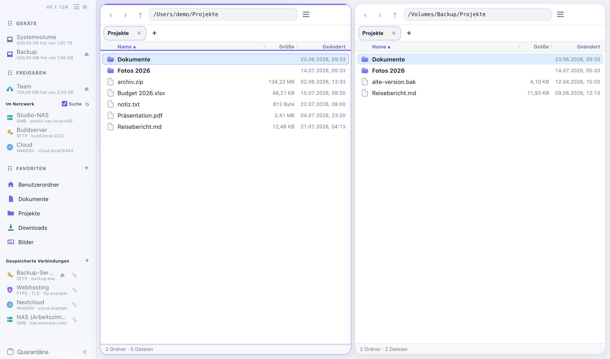
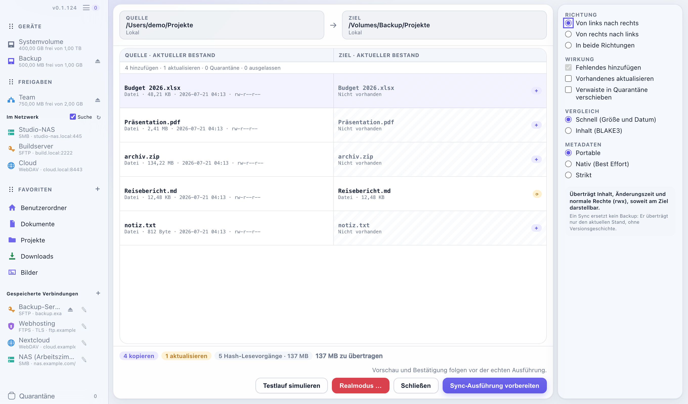

<p align="center">
  
</p>

# Doppeldecker: Ein praktischer und transparenter Dual-Pane-Dateimanager

**🌐 Sprache / Language:** [English](README.md) · [Deutsch](README.de.md)

Doppeldecker ist ein Dual-Pane-Dateimanager für macOS und Linux, gebaut für
praktische tägliche Dateiarbeit mit sichtbaren Folgen. **Du siehst destruktive
Änderungen, bevor sie passieren, und nichts wird hinter deinem Rücken gelöscht.**
Zwei Ordner liegen nebeneinander; kopieren, verschieben und synchronisieren
dazwischen — lokal oder über passende Remote-Endpunkte. FTP, FTPS, WebDAV und SMB
bieten fähigkeitsabhängige Transfers; SFTP bietet Best-Effort-Listing, geprüfte
Momentaufnahmen und additive lokale Downloads begrenzter Verzeichnisbäume.
SFTP-Ordnergrößen werden ohne Inhaltslesen als „≈“ und Best Effort angezeigt.
Nicht bedienbare Namen und fehlende Dateitypen stehen als Auslassungen in der Pane;
unabhängige gültige Dateien bleiben nutzbar.

Server bieten unterschiedliche Garantien. Doppeldecker nutzt die stärkste verfügbare
Methode, kennzeichnet verbleibende Einschränkungen ehrlich und bietet einen
abgesicherten Best-Effort-Weg, wenn sich Wirkung und Risiko noch begrenzen und prüfen
lassen. Eine Operation wird nur verweigert, wenn Ziel oder möglicher Schaden nicht
verlässlich eingegrenzt werden können.

<picture>
  <source media="(prefers-color-scheme: dark)" srcset="screenshots/overview-dark.png">
  
</picture>

## Status & Download

**0.1.124 ist die erste öffentliche Preview.** Doppeldecker ist noch vor 1.0.
Verwende beim Erproben eine Zweitkopie deiner Daten. Die Oberfläche ist deutsch.

- **macOS 14+ auf Apple Silicon:** [Signiertes und notarisiertes DMG herunterladen](https://github.com/DanielMuellerIR/Doppeldecker/releases/download/v0.1.124/Doppeldecker_0.1.124_aarch64.dmg).
  Öffne es und ziehe Doppeldecker in den Programme-Ordner. Die App enthält
  `doppeldecker-cli`; die optionale Einrichtung ersetzt keinen vorhandenen Befehl.
- **Linux Mint 22.2 / Ubuntu 24.04, x86_64:** [DEB-Paket](https://github.com/DanielMuellerIR/Doppeldecker/releases/download/v0.1.124/Doppeldecker_0.1.124_amd64.deb)
  oder [AppImage](https://github.com/DanielMuellerIR/Doppeldecker/releases/download/v0.1.124/Doppeldecker_0.1.124_amd64.AppImage).
  Das AppImage mit `chmod +x Doppeldecker_0.1.124_amd64.AppImage` ausführbar
  machen und anschließend starten.
  Andere Distributionen und Intel-Macs sind noch nicht geprüft.
- **Updates starten von Hand:** **Doppeldecker → Nach Updates suchen …** prüft einmal.
  Download und Installation brauchen eine zweite Bestätigung und eine gültige Signatur.
  Es gibt keine Hintergrundprüfung und keine stille Installation.

[Release Notes und Prüfsummen](https://github.com/DanielMuellerIR/Doppeldecker/releases/tag/v0.1.124)
· [Unterstützte Operationen und Grenzen](docs/function-audit.md).

## Was es kann

- **Vorschau, bevor etwas geschrieben wird.** Synchronisation läuft als
  `plan → execute`: Die Vorschau listet jede Kopie, Aktualisierung und Entfernung,
  die geplanten Änderungen starten erst, wenn du den gezeigten Plan bestätigst.
- **Entfernungen gehen in Quarantäne, nie direkt in den Müll.** Im Spiegelmodus
  wandern überzählige Ziele in eine laufbezogene, wiederherstellbare Quarantäne
  außerhalb des Zielbaums — mit harten Grenzen und erzwungenem Zweitscan.
- **Drei Sync-Modi.** *Nur hinzufügen* (Standard: ergänzt Fehlendes, verändert
  oder entfernt nie Vorhandenes),
  *Aktualisieren* (ergänzen und auffrischen, nie entfernen) und *Spiegeln* (die
  strengste Stufe, mit Quarantäne abgesicherte Entfernung). Wahlweise einseitig
  oder **bidirektional** gegen eine dauerhafte Baseline.
- **Remote-Ordner als vollwertige Panes.** SFTP, FTP/FTPS, WebDAV und SMB verwenden
  dasselbe ehrliche Fähigkeitsmodell wie lokale Ordner. Passwörter bleiben
  ausschließlich im System-Schlüsselbund — nie in einer Profildatei, einem Argument
  oder Log. Sichere Transporte pinnen Hostkeys oder Zertifikate. Klartext-FTP und
  FTPS ohne öffentlich geprüfte Zertifikatsidentität werden bewusst unterstützt und
  in Seitenleiste, Pane und unterer Statuszeile sichtbar gekennzeichnet. Neuer
  Ordner, Umbenennen, F5-Kopie, F6-Verschieben, Favoriten und das Öffnen einer
  verifizierten schreibgeschützten Momentaufnahme sind Aktionen der Remote-Panes.
  Je nach Server laufen sie vollständig abgesichert oder sichtbar als Best Effort;
  andernfalls nennt Doppeldecker die konkrete fehlende Voraussetzung. SFTP v3
  erlaubt sichtbar als Best Effort gekennzeichnete Ordnerlisten, geprüfte
  Momentaufnahmen und additive lokale Downloads von höchstens 100 direkten
  Auswahlen: Dateien mit je höchstens 8 GiB sowie begrenzte Verzeichnisbäume.
  Das erste OPEN oder OPENDIR bindet den Pfad nicht atomar an den Pane-Root;
  dieses Restrisiko bleibt sichtbar. Ersetzen, Sync
  und Remote-Mutationen bleiben gesperrt; [Vertrag](docs/sftp-contents.md). SMB
  erlaubt AddOnly-Uploads, aber kein zielseitiges Update/Mirror, Ersetzen oder
  Quarantäne-Restore; siehe [aktuelle Fähigkeitsmatrix](docs/function-audit.md).
- **Ziehen zum Kopieren.** Dateien oder eine Auswahl lassen sich in die andere
  Pane ziehen; Finder-Dateien auch in eine lokale oder Remote-Pane einschließlich
  FTPS. Ziel ist der angezeigte Pane-Ordner, auch über einer Ordnerzeile. Bestehende
  Namen öffnen denselben Konfliktdialog wie F5; ein Drop fordert immer eine Kopie an.
- **Eine Operations-Queue, die Abstürze übersteht.** Kopier-, Verschiebe- und
  Sync-Aufträge laufen über eine atomare, journalisierte Queue, die du pausieren,
  umordnen und stoppen kannst; nach einem Neustart prüft sie die Lage neu, bevor
  sie etwas anfasst. Mit `⌘N`/`Ctrl+N` öffnest du mehrere Fenster: Lebende
  Remote-Verbindungen stehen in allen bereit, während jedes Fenster seine eigene
  Queue besitzt und parallel übertragen kann.
- **Während Übertragungen weiterarbeiten.** Navigation, Tabs, Informationen und
  weitere Kopier-/Verschiebeaufträge bleiben erreichbar. Der laufende Auftrag
  behält seine ursprünglichen Endpunkte.
- **Native Datei-Zwischenablage.** Lokale Auswahlen mit `⌘C`/`Ctrl+C` kopieren und
  mit `⌘V`/`Ctrl+V` einfügen. macOS verschiebt mit `⌥⌘V`; unter Linux gilt
  `Ctrl+X`, danach `Ctrl+V`. Textfelder behalten ihre Textbefehle. Details und
  Plattformgrenzen stehen im [Clipboardvertrag](docs/background-file-work.md).
- **Unabhängige Tabs je Pane.** Jeder Tab hält Ordner, Verlauf, Auswahl,
  Sortierung und Scrollposition. `⌘T`/`Ctrl+T` öffnet einen Tab, `Ctrl+Tab`
  wechselt und `⌘⇧W`/`Ctrl+Shift+W` schließt ihn. Die optionale
  Sitzungswiederherstellung umfasst beide Tab-Leisten. Native macOS-Prüfungen
  belegen Tastaturbedienung und Wiederherstellung nach einem App-Neustart.
- **Ein echter Papierkorb und ehrliche Metadaten.** Löschungen nutzen einen
  descriptor-relativen Papierkorb mit Crash-Journal. Das Profil *Portable* überträgt
  Inhalte, Zeitstempel und normale Rechte; optionale *Native*-Profile übertragen
  zusätzlich Eigentümer, ACLs, erweiterte Attribute, Resource Forks, Sparse Files
  und Hardlinks — und bilanzieren pfadgenau, was sie nicht darstellen können.
- **Favoriten & Finder-Import.** Ordner an die Seitenleiste heften, per Drag & Drop
  umsortieren oder die vorhandene Finder-Seitenleiste in einem Schritt übernehmen
  (macOS).
- **Lokal & privat.** Kein zentraler Account und keine Telemetrie. Dateitransfers
  gehen ausschließlich an selbst gewählte Ziele. Native
  Tauri (Rust + System-WebView), kein Electron. Hell- und Dunkelmodus.

## Wie die Synchronisation funktioniert

Die Sync-Ansicht öffnest du über **Befehle → Synchronisieren…** (⇧⌘S). Es ist ein
bewusst betretener Modus: Die beiden Panes werden zu Quelle und Ziel, die Vorschau
zur Hauptansicht, und ein Seitenpanel hält Richtung, Wirkung, Vergleich und
Metadaten-Optionen.

Der normale lokale AddOnly-/Update-Start zeigt vor der Ausführung die konkrete
Wirkung. Reine Additionen benötigen keine Zufallsphrase; Update verlangt
ContentHash und sichert ersetzte Dateiversionen bevorzugt in Quarantäne. Schwächere
lokale Ziele erhalten einen sichtbar bestätigten Best-Effort-Weg mit getrennten
Hinweisen zu Neunamencommit und Dauerhaftigkeit. Dauerhafte Ersetzungen nennen
Umfang und fehlende Wiederherstellung ausdrücklich. Der eigene Knopf
„Testlauf simulieren“ verändert auch in einer Testsandbox keine Dateien. Mirror
behält seinen getrennten Realmodus-Assistenten. Der
[lokale Sync-Vertrag](docs/local-sync.md) nennt die aktuellen Zielgrenzen.

<picture>
  <source media="(prefers-color-scheme: dark)" srcset="screenshots/sync-dark.png">
  
</picture>

Der Vergleich läuft wahlweise schnell (Größe und Änderungszeit) oder exakt (BLAKE3-
Inhaltsdigests). Im exakten Modus gehören die Digests zum bestätigten Plan, auch vor
jeder Spiegel-Entfernung. Ein laufender Sync zeigt Fortschritt und lässt sich
abbrechen; ein Plan, der seit der Vorschau gedriftet ist, verlangt vor dem Ausführen
eine ausdrückliche Neubestätigung.

> **Ein Sync ist kein Backup.** Er überträgt nur den aktuellen Stand — keine
> Versionsgeschichte, keine Snapshots. Die Sync-Ansicht sagt das direkt neben dem
> Metadaten-Profil, damit die Grenze genau dort sichtbar ist, wo sie zählt.

## Praxistauglichkeit und Sicherheit

Doppeldecker trennt nicht verhandelbare Grenzen von gewöhnlichen
Provider-Einschränkungen. Lokale Mutationen bleiben descriptor-relativ
(`openat`/`renameat`/`unlinkat` mit `O_NOFOLLOW`), Quelle und Ziel dürfen weder
gleich noch ineinander verschachtelt sein, Secrets gelangen nie in Argumente oder
Logs, und ein unerwarteter Wechsel von Server- oder Root-Identität stoppt die
Operation.

Innerhalb dieser Grenzen werden Fähigkeiten abgestuft statt nur erlaubt oder
gesperrt. Eine vollständig geprüfte Operation läuft normal. Eine
Best-Effort-Operation erhält eine frische Vorprüfung, bei Bedarf einen konkreten
Hinweis, eine ausdrückliche Konfliktentscheidung, einen Readback danach und eine
ehrliche Auditbilanz. Nur eine nicht begrenzbare oder mehrdeutige Wirkung wird
verweigert. Entfernungen im Spiegelmodus benötigen wegen ihrer großen Wirkung
weiterhin vollständige Listings, sichtbare Grenzen und eine ausdrückliche
Bestätigung. Siehe
[`docs/product-principles.md`](docs/product-principles.md).

## Headless & CLI

Der korrektheitskritische Kern (Sync-Engine, Dateioperationen) ist **vollständig
ohne GUI** prüfbar, auf macOS und Linux identisch — ideal für CI und Automatisierung:

```bash
cargo test -p doppeldecker-core      # Sync-Engine-Tests (macOS + Linux)
cargo test -p doppeldecker-cli       # das CLI-Protokoll in künstlichen Temp-Bäumen
```

Der unterstützte Kommandozeilen-Einstieg bietet einen reinen Dry-Run-Plan, einen
bestätigten lokalen Realmodus, lokales/entferntes `mkdir`, `list`, `sync`, `copy`,
`move` und `rename`, lokales `trash`, fähigkeitsabhängiges Remote-`delete`,
Capability-Abfrage und Quarantäne-Verwaltung.
Gespeicherte Profile und Schlüsselbundreferenzen werden aufgelöst, ohne Secrets als
Argument anzunehmen; Kernpläne, Bestätigungen, Driftprüfung und Auditverträge
entsprechen der GUI. `--json` schreibt JSON Lines auf stdout. Siehe
[`docs/headless-cli.md`](docs/headless-cli.md).
Die gepackte macOS-App bietet beim ersten Start an, ihr mitgeliefertes CLI als
`doppeldecker-cli` erreichbar zu machen; die Linux-Pakete installieren dasselbe
Binary neben der GUI.

## Aus dem Quelltext bauen

Voraussetzung: eine Rust-Toolchain ([rustup](https://rustup.rs)). Für Linux-GUI-Builds
zusätzlich `libwebkit2gtk-4.1-dev` und `build-essential`.

```bash
cargo run   -p doppeldecker          # App starten
cargo build -p doppeldecker --release
cargo build -p doppeldecker-cli --release
```

Die Anwendung selbst benötigt kein Node. Die reproduzierbare Browser-Testsuite (gegen
einen kontrollierten Tauri-Mock) nutzt Node 20+ und Playwright:

```bash
pnpm install --frozen-lockfile
pnpm exec playwright install chromium
pnpm test:ui
```

Architektur sowie die Produkt-, Sicherheits-, Provider- und Releaseverträge:
[`AGENTS.md`](AGENTS.md) · [`docs/INDEX.md`](docs/INDEX.md) ·
[`CHANGELOG.md`](CHANGELOG.md) · [`backlog.md`](backlog.md).

## Lizenz

[MIT](LICENSE), © 2026 Daniel Müller. Doppeldecker vendort einen kleinen
SMB-Capability-Patch und hängt von Rust-Drittbibliotheken ab; deren Lizenzen und
Hinweise liegen bei ihren Quellen.

## Support und Datenschutz

[Fehler melden und Support](https://github.com/DanielMuellerIR/Doppeldecker/issues) ·
[Impressum](https://dm0.de/impressum.html) ·
[Datenschutz](https://dm0.de/datenschutz.html#doppeldecker).
Diese Links stehen auch in der App unter **Einstellungen**.

Die App sendet keine Telemetrie und keine automatischen Absturzberichte.
Einstellungen, Profile und Fehlerlogs werden lokal gespeichert. Dateiübertragungen,
Remote-Verbindungen und Updateprüfungen verwenden die von dir gewählten Ziele.
Passwörter und private Dateipfade gehören nicht in öffentliche Fehlermeldungen.
