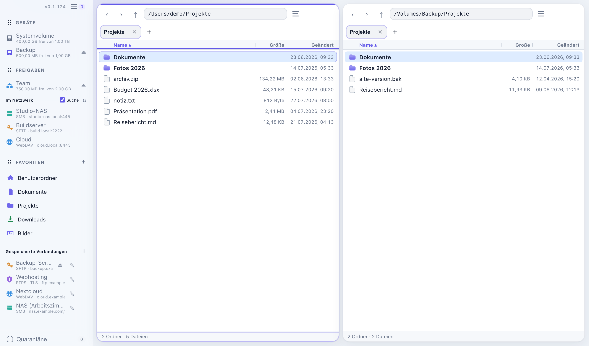

<p align="center">
  
</p>

# Doppeldecker

**Sprache / Language:** [English](README.md) · [Deutsch](README.de.md)

Ein Two-Pane-Dateimanager für macOS und Linux: lokale und entfernte Dateien
kopieren, verschieben, durchsuchen und synchronisieren. Die Oberfläche ist deutsch.

<picture>
  <source media="(prefers-color-scheme: dark)" srcset="screenshots/overview-dark.png">
  
</picture>

## Download

**Öffentliche Preview: 0.1.125.** Verwende beim Erproben eine Zweitkopie deiner Daten.

| System | Paket |
| --- | --- |
| macOS 14+, Apple Silicon | [Signiertes und notarisiertes DMG](https://github.com/DanielMuellerIR/Doppeldecker/releases/download/v0.1.125/Doppeldecker_0.1.125_aarch64.dmg) |
| Linux Mint 22.2 / Ubuntu 24.04, x86_64 | [DEB](https://github.com/DanielMuellerIR/Doppeldecker/releases/download/v0.1.125/Doppeldecker_0.1.125_amd64.deb) · [AppImage](https://github.com/DanielMuellerIR/Doppeldecker/releases/download/v0.1.125/Doppeldecker_0.1.125_amd64.AppImage) |

Unter macOS die App aus dem DMG nach Programme ziehen. Andere Distributionen und
Intel-Macs sind noch nicht geprüft. **Doppeldecker → Nach Updates suchen …** prüft
nur auf Wunsch; Download und Installation benötigen eine eigene Bestätigung.

[Release Notes und Prüfsummen](https://github.com/DanielMuellerIR/Doppeldecker/releases/tag/v0.1.125).
[Änderungen dieser Preview](docs/release-notes-0.1.125.md).

## Funktionen

- **Dateiarbeit:** F5 kopiert, F6 verschiebt; außerdem Ordner anlegen, umbenennen,
  lokale Objekte duplizieren, Drag & Drop und native Datei-Zwischenablage.
  Gewöhnliche Aktionen starten direkt; Kollisionen erhalten passende Entscheidungen.
- **Remote-Panes:** SFTP, FTP/FTPS, WebDAV und SMB, auch zum Öffnen und externen
  Bearbeiten mit ausdrücklichem Zurückspeichern. Passwörter bleiben im Schlüsselbund.
- **Navigation:** mehrere Fenster mit eigener Queue, unabhängige Pane-Tabs,
  Favoriten, Schnellfilter, rekursive Namenssuche und manuelle Ordnergrößen.
  Während Übertragungen bleibt die Navigation bedienbar.
- **Vorschau:** F3 zeigt lokale und entfernte UTF-8-Texte sowie PNG-/JPEG-Bilder.
- **Stapel und Archive:** Namen per Vorschau ändern, einschließlich Namenzyklen;
  lokale Auswahlen als ZIP packen und zur entfernten Pane hochladen; ZIPs durchsuchen
  und ganze Archive oder einzelne Inhalte in lokale oder entfernte Ziele entpacken.
- **Dateieigenschaften:** normale Unix-Rechte lokal/SFTP/FTP ändern, auch rekursiv;
  lokale Eigentümer/Gruppe bearbeiten, auf macOS und Linux optional mit Administratorfreigabe.
  Dort auch Finder-Tags, Kommentare, Sichtbarkeit und Dateisperren ändern.
- **Synchronisation:** Nur hinzufügen, Aktualisieren und Spiegeln mit konkreter
  Vorschau; einseitig oder bidirektional mit gespeicherter Baseline.
- **Queue und Wiederherstellung:** Aufträge pausieren und abbrechen; nach Neustart
  Endpunkte und Wirkung neu prüfen. Lokales Löschen nutzt den Systempapierkorb.

## Grenzen und Datenintegrität

Die [Funktionsmatrix](docs/function-audit.md) nennt den tatsächlichen Umfang je
Provider. Fehlende Protokollgarantien werden als Best Effort angezeigt. SFTP kann
einen gleichzeitigen serverseitigen Elternpfadtausch nicht atomar ausschließen.
Klartext-FTP und FTPS ohne öffentlich geprüfte Zertifikatsidentität sind möglich
und sichtbar gekennzeichnet; `ftps://` fällt nie still auf Klartext zurück.

Starke lokale Syncziele sichern Ersetzungen und Spiegel-Entfernungen in Quarantäne.
Gewöhnlicher Remote-Sync kann nach konkreter Bestätigung endgültig ersetzen und
entfernen. Ein Sync besitzt keine Versionsgeschichte und ersetzt kein Backup.
Native Metadatenprofile gelten für Sync; darstellbare Klassen und Auslassungen
hängen vom Ziel ab. Normale Kopien haben ihren eigenen Metadatenumfang.
[Sync-Vertrag](docs/content-sync.md) · [Metadaten](docs/forklift-parity.md).

## CLI und Entwicklung

`doppeldecker-cli` verwendet denselben Kern, gespeicherte Profile und gebundene
Ausführungspläne. `--json` liefert JSON Lines; Secrets werden nicht als Argumente
angenommen. Die macOS-App bietet eine optionale CLI-Einrichtung an, ohne vorhandene
Befehle zu ersetzen; Linux-Pakete enthalten beide Programme.
[CLI-Bedienung](docs/headless-cli.md).

[Linux-Funktionen, benutzereigene Installation und GitHub-Updates](docs/linux.md).

Voraussetzung ist [Rust](https://rustup.rs); Linux-GUI-Builds benötigen außerdem
`libwebkit2gtk-4.1-dev` und `build-essential`. Die App verwendet Tauri mit dem
System-WebView und benötigt kein Node. Das Packen eines AppImage benötigt
zusätzlich `patchelf`, `gstreamer1.0-tools` und `gstreamer1.0-plugins-base`.

```bash
cargo run -p doppeldecker
cargo build -p doppeldecker --release
cargo build -p doppeldecker-cli --release
```

Für Browserprüfungen: Node 20+, `pnpm install --frozen-lockfile`,
`pnpm exec playwright install chromium`, dann `pnpm test:ui`.
[Build- und Testregeln](AGENTS.md) · [Dokumentationsindex](docs/INDEX.md).

[Roadmap](docs/roadmap.md) · [Offene Aufgaben](backlog.md) · [Änderungen](CHANGELOG.md).

## Lizenz, Support und Datenschutz

[MIT](LICENSE), © 2026 Daniel Müller. Hinweise zu Drittbibliotheken einschließlich
des vendorten SMB-Patches liegen bei ihren Quellen.

[Fehler melden](https://github.com/DanielMuellerIR/Doppeldecker/issues) ·
[Impressum](https://dm0.de/impressum.html) ·
[Datenschutz](https://dm0.de/datenschutz.html#doppeldecker).

Kein zentraler Account, keine Telemetrie und keine automatischen Absturzberichte.
Verbindungen und Updateprüfungen kontaktieren die gewählten Endpunkte. Passwörter
und private Dateipfade gehören nicht in öffentliche Fehlermeldungen.
