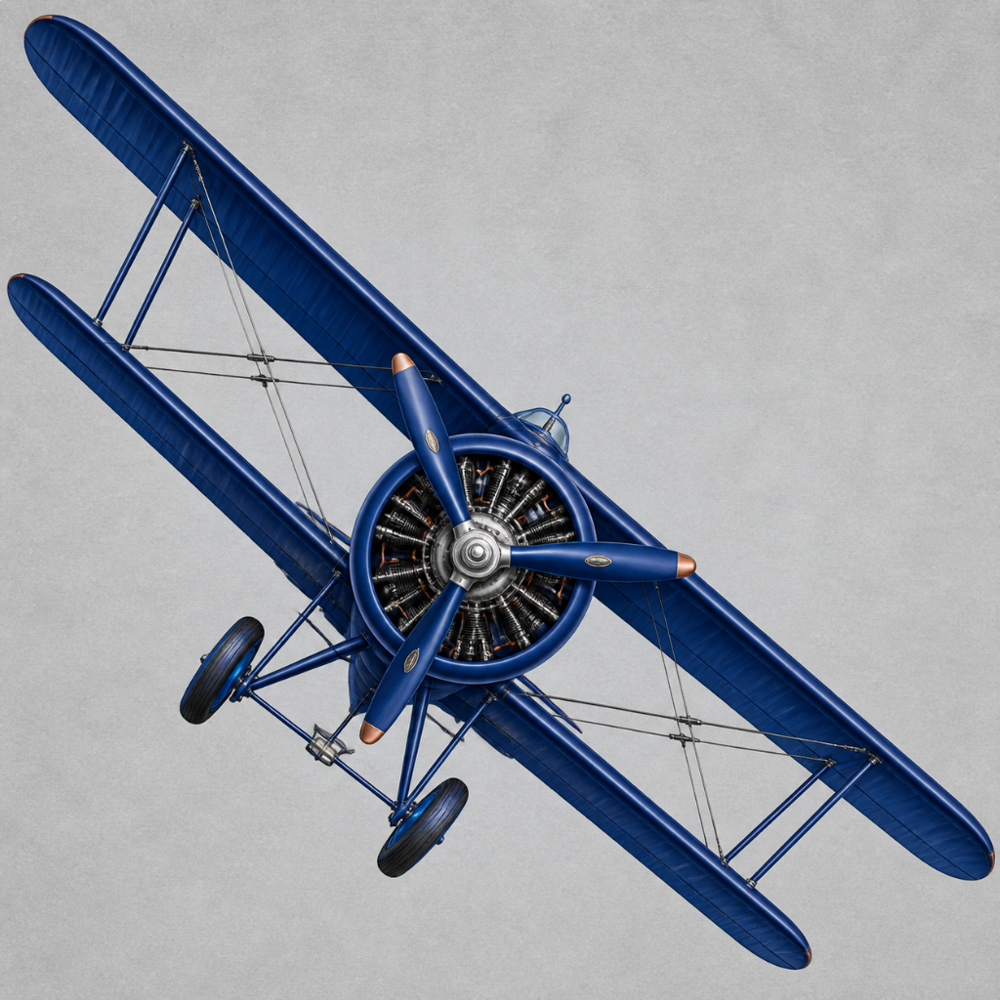
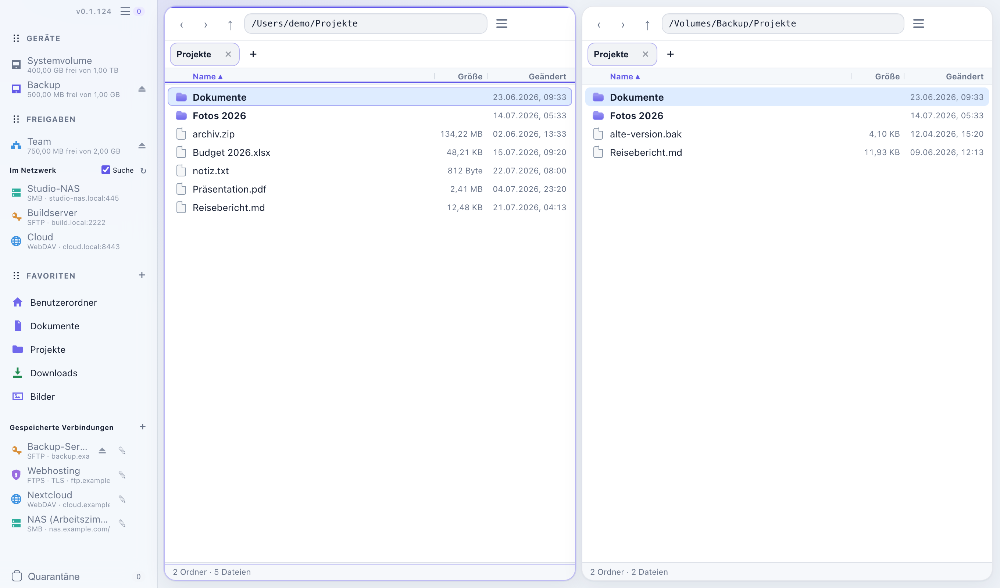

<p align="center">
  
</p>

# Doppeldecker

**Sprache / Language:** [English](README.md) · [Deutsch](README.de.md)

A dual-pane file manager for macOS and Linux: copy, move, search and synchronize
local and remote files. The interface is currently German-only.

<picture>
  <source media="(prefers-color-scheme: dark)" srcset="screenshots/overview-dark.png">
  
</picture>

## Download

**Public preview: 0.1.125.** Use a second copy of your data while evaluating it.

| System | Package |
| --- | --- |
| macOS 14+, Apple Silicon | [Signed and notarized DMG](https://github.com/DanielMuellerIR/Doppeldecker/releases/download/v0.1.125/Doppeldecker_0.1.125_aarch64.dmg) |
| Linux Mint 22.2 / Ubuntu 24.04, x86_64 | [DEB](https://github.com/DanielMuellerIR/Doppeldecker/releases/download/v0.1.125/Doppeldecker_0.1.125_amd64.deb) · [AppImage](https://github.com/DanielMuellerIR/Doppeldecker/releases/download/v0.1.125/Doppeldecker_0.1.125_amd64.AppImage) |

On macOS, drag the app from the DMG to Applications. Other distributions and Intel
Macs are not yet verified. **Doppeldecker → Nach Updates suchen …** checks on
request; downloading and installing require a separate confirmation.

[Release notes and checksums](https://github.com/DanielMuellerIR/Doppeldecker/releases/tag/v0.1.125).
[Changes in this preview (German)](docs/release-notes-0.1.125.md).

## Features

- **File work:** F5 copies, F6 moves; create folders, rename, duplicate local
  objects, drag and drop, and use the native file clipboard. Ordinary actions
  start directly; conflicts receive the appropriate choices.
- **Remote panes:** SFTP, FTP/FTPS, WebDAV and SMB, including opening files and
  external editing with explicit save-back. Passwords remain in the system keychain.
- **Navigation:** multiple windows with separate queues, independent pane tabs,
  favorites, quick filters, recursive name search and manual folder sizes.
  Navigation remains available during transfers.
- **Preview:** F3 displays local and remote UTF-8 text and PNG/JPEG images.
- **Batch work and archives:** preview batch renames, including name cycles;
  create ZIPs from local selections and upload them to the remote pane; browse ZIPs
  and extract whole archives or individual entries to local or remote destinations.
- **File properties:** edit ordinary Unix permissions locally or over SFTP/FTP,
  including recursively; edit local owner/group, optionally with administrator
  authorization on macOS and Linux. Edit Finder tags, comments, visibility and locks on macOS.
- **Synchronization:** Add only, Update and Mirror with a concrete preview;
  one-way or bidirectional with a stored baseline.
- **Queue and recovery:** pause and cancel jobs; recheck endpoints and effects
  after restarting. Local deletion uses the system trash.

## Limits and data integrity

The [operation matrix](docs/function-audit.md) describes each provider's actual
scope. Missing protocol guarantees are shown as best effort. SFTP cannot atomically
exclude a concurrent server-side parent-path swap. Plain FTP and FTPS without a
publicly verified certificate identity are supported and visibly labelled;
`ftps://` never silently falls back to plaintext.

Strong local sync destinations quarantine replacements and mirror removals.
Ordinary remote sync can permanently replace and remove entries after concrete
confirmation. Sync has no version history and does not replace a backup.
Native metadata profiles apply to sync; supported classes and omissions depend
on the destination. Ordinary copies have their own metadata scope.
[Sync contract](docs/content-sync.md) · [Metadata scope](docs/forklift-parity.md).

## CLI and development

`doppeldecker-cli` uses the same core, stored profiles and bound execution plans.
`--json` emits JSON Lines; secrets are not accepted as arguments. The macOS app
offers optional CLI setup without replacing existing commands; Linux packages
contain both programs. [CLI usage](docs/headless-cli.md).

[Linux features, per-user installation and GitHub updates](docs/linux.md) (German).

Builds require [Rust](https://rustup.rs); Linux GUI builds also need
`libwebkit2gtk-4.1-dev` and `build-essential`. The app uses Tauri with the system
WebView and does not require Node. AppImage packaging additionally needs
`patchelf`, `gstreamer1.0-tools` and `gstreamer1.0-plugins-base`.

```bash
cargo run -p doppeldecker
cargo build -p doppeldecker --release
cargo build -p doppeldecker-cli --release
```

Browser tests require Node 20+, `pnpm install --frozen-lockfile`,
`pnpm exec playwright install chromium`, then `pnpm test:ui`.
[Build and test rules](AGENTS.md) · [Documentation index](docs/INDEX.md).

[Roadmap](docs/roadmap.md) · [Open tasks](backlog.md) · [Changes](CHANGELOG.md).

## License, support and privacy

[MIT](LICENSE), © 2026 Daniel Müller. Third-party notices, including those for the
vendored SMB patch, accompany their sources.

[Report an issue](https://github.com/DanielMuellerIR/Doppeldecker/issues) ·
[Legal notice](https://dm0.de/impressum.html) ·
[Privacy](https://dm0.de/datenschutz.html#doppeldecker).

No central account, telemetry or automatic crash reports. Connections and update
checks contact the selected endpoints. Do not include passwords or private file
paths in public issues.
